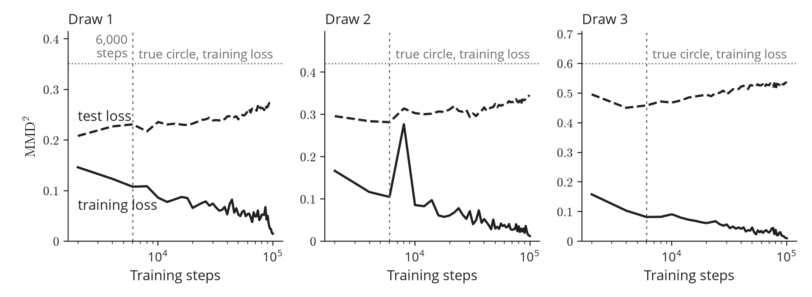
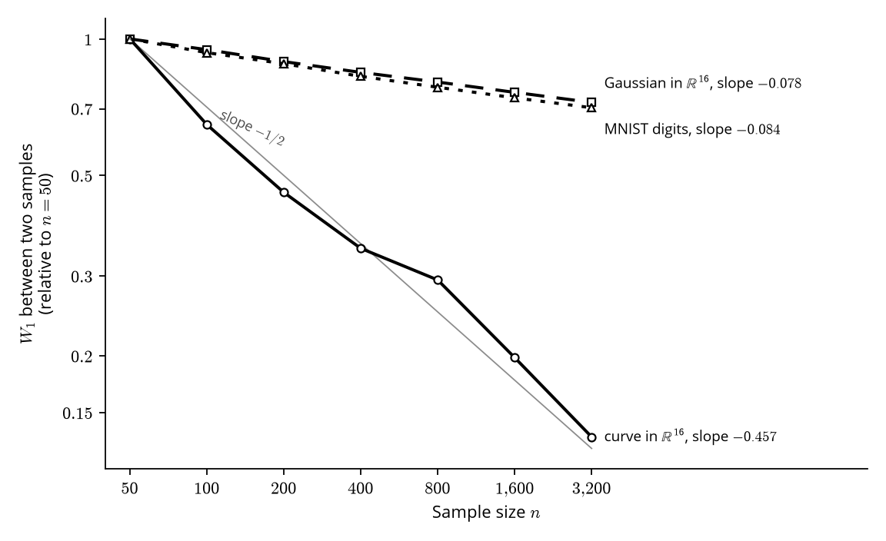
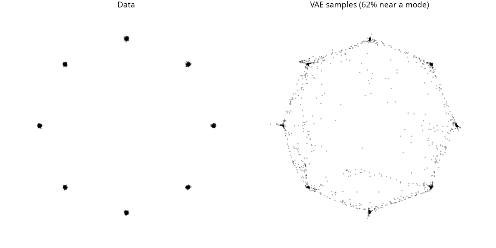

# Generative models for images: code and results

This repository holds the experiments of the course [Generative Models for Images](https://ibouftini.github.io/courses/generative-models/). It covers the first three chapters. Every figure of these chapters comes from a script here, and every number they report comes from a results file here. A test compares each quoted number with its source.

## Check it

These steps need no GPU and take a few minutes. They use the results, samples and weights stored in the repository.

```bash
git clone https://github.com/ibouftini/generative-models-lab
cd generative-models-lab
pip install -r requirements.txt
make test      # compares the numbers quoted in the chapters with results/, checks known answers
make figures   # redraws every figure into figures/ from the saved files, trains nothing
```

MNIST is downloaded on first use. The figures use the Open Sans font (`apt install fonts-open-sans`).

To retrain, send the output to another folder so the published files stay untouched, then compare the two.

```bash
export LAB_CHECKPOINTS=/tmp/rerun/checkpoints LAB_RESULTS=/tmp/rerun/results LAB_FIGURES=/tmp/rerun/figures
make chapter2 chapter3 chapter1    # about 10 h on an RTX 3050, nearly all of it Chapter 1
python -m lab.compare /tmp/rerun/results
```

## Chapter 1

[Learning a distribution](https://ibouftini.github.io/courses/generative-models/learning-a-distribution/) trains generators on points of a circle and measures when they memorize the training points.



| Experiment | Command | Time | Results |
|---|---|---|---|
| WGAN-GP on MNIST, the digits of the opening figure | `python -m chapter1.generator train` | 3 h | `checkpoints/mnist_wgan_gp.pt` |
| Circle generators, 43 runs over width and number of points | `python -m chapter1.memorization run` | 5.4 h | `results/chapter1/memorization-sweeps.json` |
| The same with a one-dimensional latent, 12 runs | `python -m chapter1.memorization latent` | 1.6 h | `results/chapter1/memorization-sweeps-k1.json` |
| Training loss, test loss and copies of the MNIST generator | `python -m chapter1.memorization mnist` | 2 min | `results/chapter1/mnist-wgan-losses.json` |

The schematics come from `chapter1/pushforward.py`, `chapter1/manifold.py` and `chapter1/no_density.py`.

## Chapter 2

[Comparing distributions](https://ibouftini.github.io/courses/generative-models/comparing-distributions/) measures how fast the Wasserstein distance between two samples shrinks with their size, and fits a Gaussian to two modes in each direction of KL.



| Experiment | Command | Time | Results |
|---|---|---|---|
| Exact Wasserstein distance between samples, up to 3,200 points | `python -m chapter2.rates run` | 30 s | `results/chapter2/rates.json` |
| Forward and reverse KL fits | `python -m chapter2.kl_directions run` | 10 s | `results/chapter2/kl-directions.json` |

The figure of the four distances between two uniform distributions comes from `chapter2/two_uniforms.py`.

## Chapter 3

[Variational autoencoders](https://ibouftini.github.io/courses/generative-models/variational-autoencoders/) trains autoencoders and VAEs on MNIST and measures where the VAE succeeds and fails.



| Experiment | Command | Time | Results |
|---|---|---|---|
| Autoencoders and VAEs, codes of size 2 and 8 | `python -m chapter3.autoencoder train`, `python -m chapter3.vae train` | 7 min | `checkpoints/` |
| Share of decoded prior samples recognized as digits, spread of the codes | `python -m chapter3.vae_numbers` | 20 s | `results/chapter3/vae-numbers.json` |
| VAE on eight separated clusters | `python -m chapter3.experiments ring` | 1 min | `results/chapter3/ring.json` |
| Rate and distortion over seven values of beta | `python -m chapter3.experiments beta` | 3 min | `results/chapter3/beta.json` |
| Prior samples the classifier does not recognize | `python -m chapter3.experiments holes` | 10 s | `results/chapter3/holes.json` |
| Linear collapse rule against the active coordinates | `python -m chapter3.experiments linear` | 10 s | `results/chapter3/linear-collapse.json` |
| Best decoder variance and a VAE trained with it | `python -m chapter3.experiments calibrate` | 1 min | `results/chapter3/calibrated.json` |
| Importance sampling with the prior and with the encoder | `python -m chapter3.experiments estimators` | 15 s | `results/chapter3/estimators.json` |
| High-frequency share of the images, a measure of blur | `python -m chapter3.experiments blur` | 10 s | `results/chapter3/blur.json` |

The linear-model figure comes from `chapter3/linear_model.py`. The decoder of the interactive latent explorer comes from `python -m chapter3.experiments export`.

## Reproducibility

Every experiment except the last 14 of the 55 circle runs was retrained from scratch on the machine that produced the published files, an RTX 3050 Laptop GPU (4 GB) with the library versions of `requirements.txt`. The two sets of results were then compared with `python -m lab.compare`, leaving out run times.

| Results | Identical numbers | Cause of the differences |
|---|---:|---|
| Chapter 1, circle generators, 41 of 55 runs | 644 of 644 | None |
| Chapter 1, MNIST generator | 7 of 11 | Retrained WGAN-GP |
| Chapter 2, all | 58 of 58 | None |
| Chapter 3, clusters, beta, blur, estimators, linear collapse | 131 of 131 | None |
| Chapter 3, recognized shares, holes, calibrated decoder | 36 of 53 | Retrained classifier |

Two trainings do not repeat from one run to the next, even with the same seed: the MNIST classifier and the WGAN-GP. They are the only convolutional networks in the repository, so GPU convolutions are the likely cause, although this was not tested further. The autoencoders and VAEs came back with identical weights. With the published classifier and generator from `checkpoints/`, all 64 numbers in the two affected rows match exactly.

Retraining those two networks changes the numbers as follows.

| Number | Published | Retrained |
|---|---:|---:|
| VAE samples recognized as digits | 46.7% | 47.2%, and 46.3% in an earlier retraining |
| Autoencoder samples recognized as digits | 0.3% | 0.1%, and 0.4% in an earlier retraining |
| Test accuracy of the classifier | 98.89% | 98.88%, and 98.87% in an earlier retraining |
| Copies among the samples of the MNIST generator | 0.20% | 0.30% |

Real test images score 1.15% on the last line, so the generator stays below them in both trainings. The two retrainings of the classifier are stored in `results/chapter3/vae-numbers-rerun.json` and `vae-numbers-rerun-2.json`.

A fresh copy with no GPU and a new MNIST download passes all 127 tests in about 3 minutes. It redraws 23 of the 24 files in `figures/` byte for byte, in under a minute. The other file, `mnist-generated.png`, shows the same digits with 0.41% of its pixels off by one level out of 255.

Retraining on a CPU gives different numbers. In the eight-cluster experiment, the share of good samples moves from 61.52% to 61.60%, and the share of one cluster from 6.78% to 9.28%. Other GPUs and library versions were not tested.

## Layout

```
lab/         data, measures, results files and figure style, shared by the chapters
chapter1/    one script per experiment or figure
chapter2/
chapter3/
tests/       test_quoted_numbers.py compares the chapters with results/, test_known_answers.py checks the code
results/     one JSON per experiment: numbers, configuration, seed, script, library versions, device, date
checkpoints/ trained weights and saved samples, so that figures need no training
figures/     the figures of the course, as the scripts write them
```

The SVG schematics are written for inlining in the course pages, which style their classes and typeset their labels with KaTeX. Opened alone they show raw TeX labels, so read them in the chapters.

## License

The code is under the [MIT License](LICENSE). The text of the course is not part of this repository.
